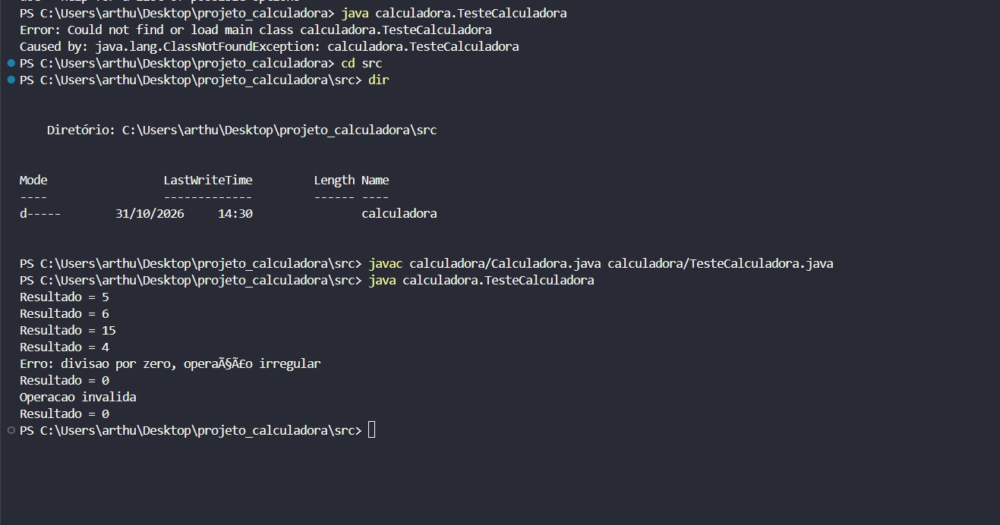
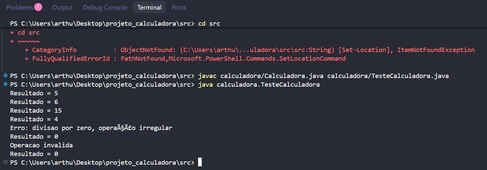
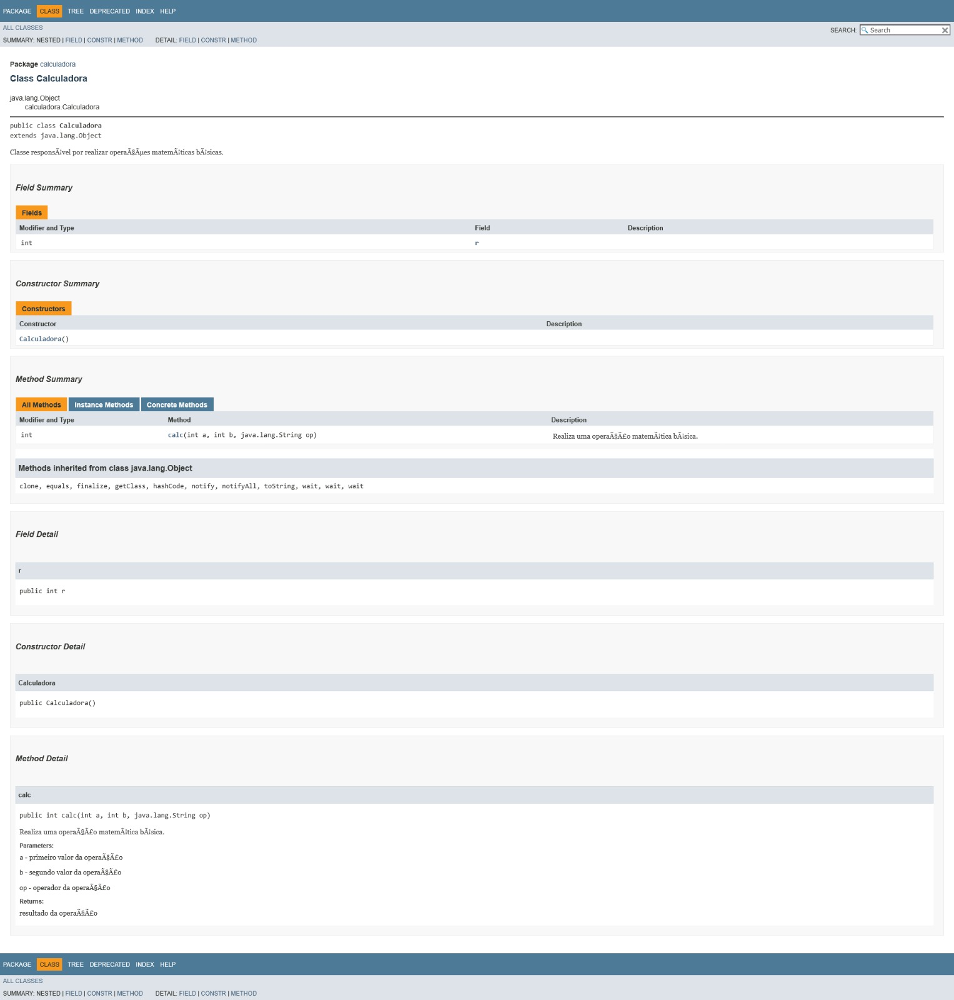
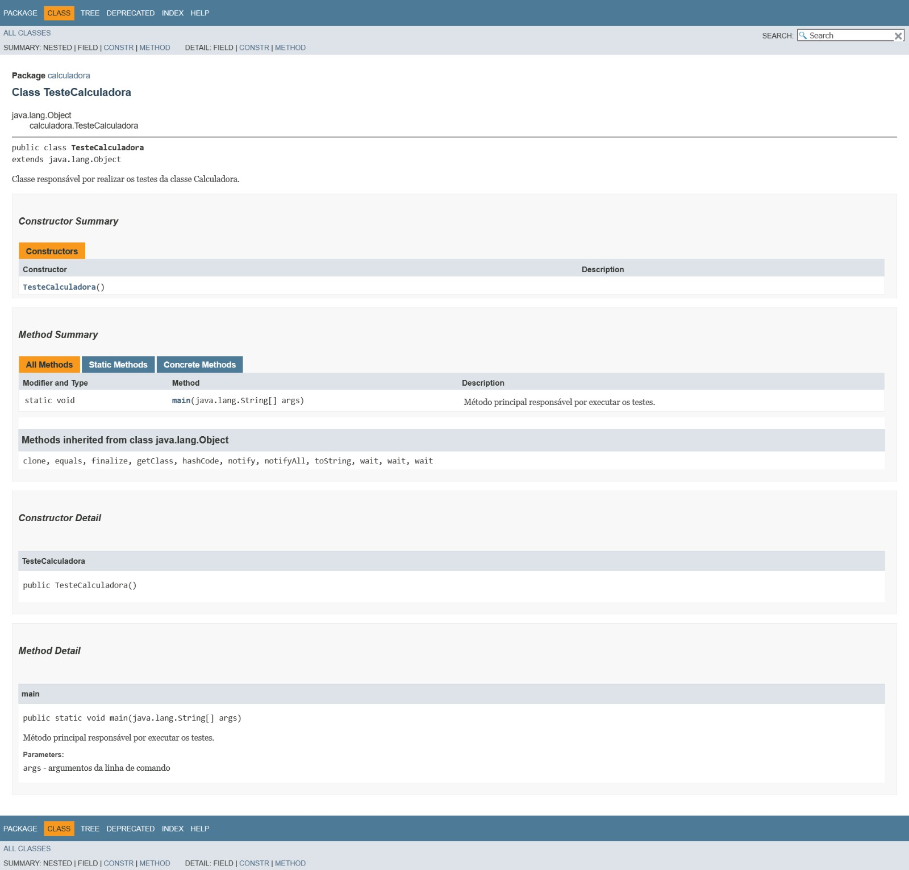

# Projeto Calculadora

Projeto desenvolvido para a atividade da disciplina **UX/UI e Testes de Software**, com o objetivo de implementar, testar, refatorar e documentar uma calculadora simples em Java.

## Objetivo

Desenvolver uma aplicação capaz de realizar operações matemáticas básicas, realizar testes das funcionalidades implementadas, aplicar técnicas de refatoração e gerar a documentação do código utilizando JavaDoc.

## Tecnologias utilizadas

- Java 11
- Visual Studio Code
- PowerShell
- JavaDoc
- Git
- GitHub

## Funcionalidades

A calculadora realiza as seguintes operações:

- Adição (`+`)
- Subtração (`-`)
- Multiplicação (`*`)
- Divisão (`/`)
- Tratamento de divisão por zero
- Tratamento de operação inválida

## Estrutura do projeto

```text
projeto_calculadora/
├── src/
│   └── calculadora/
│       ├── Calculadora.java
│       └── TesteCalculadora.java
│
└── docs/
    └── Documentação gerada pelo JavaDoc
```

## Testes realizados

Foram realizados testes para verificar o funcionamento das operações:

| Teste | Entrada | Resultado esperado |
|---|---|---:|
| Adição | `2 + 3` | 5 |
| Subtração | `10 - 4` | 6 |
| Multiplicação | `3 * 5` | 15 |
| Divisão | `8 / 2` | 4 |
| Divisão por zero | `8 / 0` | 0 |
| Operação inválida | `5 x 5` | 0 |

Os testes foram executados por meio da classe `TesteCalculadora`.

## Refatoração

Foi criada a branch **Refatoracao** para realizar melhorias no código sem alterar o objetivo principal da aplicação.

Entre as alterações realizadas estão:

- Substituição da estrutura de `if/else` por `switch`.
- Extração da operação de divisão para um método separado.
- Organização da estrutura do código.
- Manutenção do tratamento de divisão por zero e operações inválidas.

Após a refatoração, os testes foram executados novamente para verificar o funcionamento da aplicação.

## Documentação JavaDoc

A documentação do código foi criada utilizando **JavaDoc**.

Foram documentados:

- Classe `Calculadora`
- Atributo `r`
- Método `calc`
- Parâmetros do método `calc`
- Retorno do método `calc`
- Classe `TesteCalculadora`
- Método `main`
- Parâmetro `args`

Também foram utilizadas as tags:

- `@author`
- `@version`
- `@param`
- `@return`

A documentação HTML foi gerada na pasta `docs`.

## Evidências

### Execução dos testes



### Execução após a refatoração



### Documentação JavaDoc

#### Classe Calculadora



#### Classe TesteCalculadora



## Autor

**Arthur**

Projeto desenvolvido para a disciplina de **UX/UI e Testes de Software**.